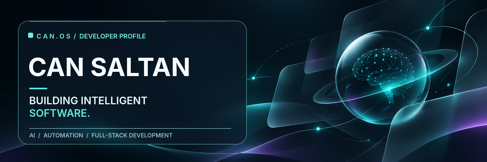
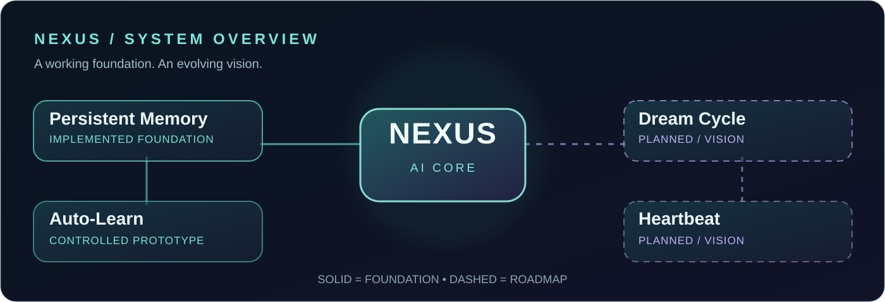

**Can Saltan** · Business Informatics @ Fulda University of Applied Sciences  
*Software Development · AI · Automation*

**[◈ Launch CAN.OS](https://cansaltan.github.io/)** · [LinkedIn](https://www.linkedin.com/in/can-saltan-218a08445/) · [Repositories](https://github.com/cansaltan?tab=repositories)

Click the banner to explore my interactive developer portfolio.

---

### `01 / CURRENTLY BUILDING`

**Nexus AI** — a personal AI assistant project exploring how software can retain useful context, learn transparently and support people while keeping them in control.

- **Built foundations:** React/TypeScript interface, Node.js backend, SQLite memory with provenance and user controls, conservative Auto-Learn pipeline, and a guarded OpenRouter adapter (live inference not enabled in the documented version).
- **Long-term vision:** Dream Cycle, proactive Heartbeat routines, specialized agents and permission-based automation.

<strong>Explore the Nexus architecture</strong> · implemented foundations vs. future vision

 

Nexus is in active development. Future capabilities shown in the diagram are **not** presented as shipped features.

**Stack:** `React` · `TypeScript` · `Node.js` · `Express` · `SQLite`

### `02 / SELECTED WORK`

| Project | What it is | Status |
| :--- | :--- | :--- |
| **[CAN.OS](https://cansaltan.github.io/)** · [Source](https://github.com/cansaltan/cansaltan.github.io) | Interactive glassmorphism developer portfolio with a Nexus-inspired control interface | **Live · Public beta** |
| **Nexus AI** | Personal AI assistant with persistent memory and contextual learning | **In development · Private repo** |
| **Nodi** | Exploring repetitive email patterns and workflow automation | **Early-stage concept** |

### `03 / TOOLKIT`

**Languages:** `TypeScript` · `JavaScript` · `Java` · `SQL` · `HTML` · `CSS`  
**Tools & frameworks:** `React` · `Node.js` · `Express` · `Bootstrap` · `SQLite` · `Git` · `VS Code`

### `04 / CONNECT`

I'm open to **working-student opportunities** in software development, AI and IT.  
[Connect with me on LinkedIn](https://www.linkedin.com/in/can-saltan-218a08445/) · [Explore my portfolio](https://cansaltan.github.io/)

---

  CAN.OS / Building, learning, iterating.

